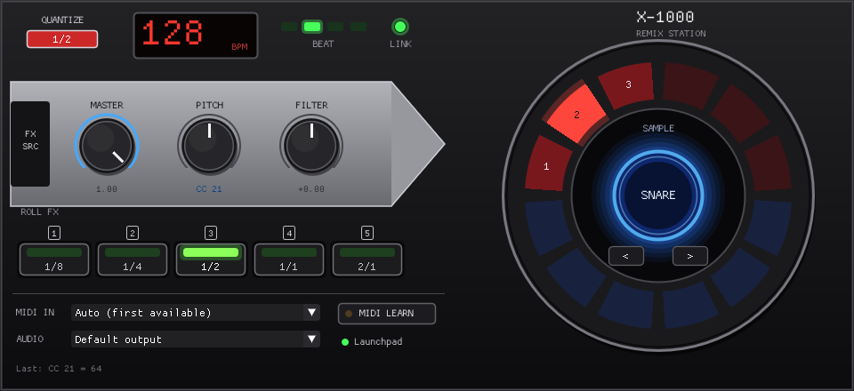
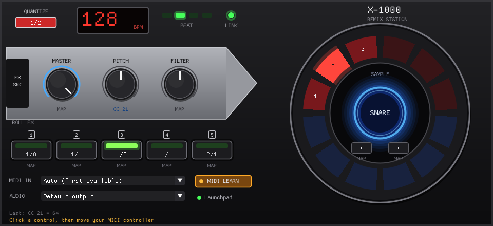

      <h1>X-1000</h1>

  
Software to simulate the Pioneer RMX-1000 X-Pads and create incredible build-ups. 
Fully mappable to MIDI controllers, featuring native Pitch and Filter effects applicable to the Roll.

---

## Why

The Pioneer RMX-1000 Sample Roll (X-Pad) costs around $1,000 (≈ R$12,000 in Brazil).
X-1000 gives you the same build-up experience with any inexpensive MIDI controller.

## Features

- **Roll FX** with 1/8, 1/4, 1/2, 1/1 and 2/1 quantization, synced to Ableton Link
- **Pitch** and **Filter** applied directly to the roll, plus a **Master** level
- **Sample ring** to pick the sample, with a beat-synced glow
- **MIDI Learn** for every control: roll buttons, knobs and sample prev/next
- MIDI input and audio output selectable from the UI

## Usage

1. Download the latest build from [Releases](https://github.com/manoelpiovesan/x-1000/releases/latest).
2. Pick your **MIDI IN** and **AUDIO** devices.
3. Enable **MIDI LEARN**, click a control, then move or press the one on your controller.
4. Drag knobs vertically (hold `Shift` for fine control, double click to reset).

## Support

If X-1000 helps you, leave a star on GitHub or [buy me a coffee on Ko-fi](https://ko-fi.com/L3L61SRB88).

with a donation on **Ko-fi**. Every contribution helps cover development time, maintenance, and future improvements.

**☕ Buy me a coffee:** https://ko-fi.com/L3L61SRB88

## Contributing
Contributions are welcome! If you have any ideas, suggestions, or improvements, please feel free to submit a 
pull request or open an issue. Let's work together to make this project even better!

## License

Copyright (C) 2026 Manoel Rodrigues

This project is licensed under the GNU General Public License v3.0 (GPL-3.0).

You are free to use, study, modify, and redistribute this software under the terms of the GPL v3. Any distributed modified version must also be licensed under GPL v3 and include its complete corresponding source code.

See the [LICENSE](LICENSE) file for details.
